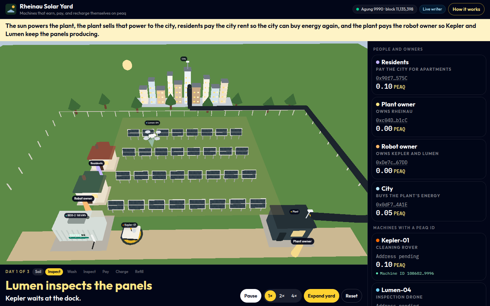
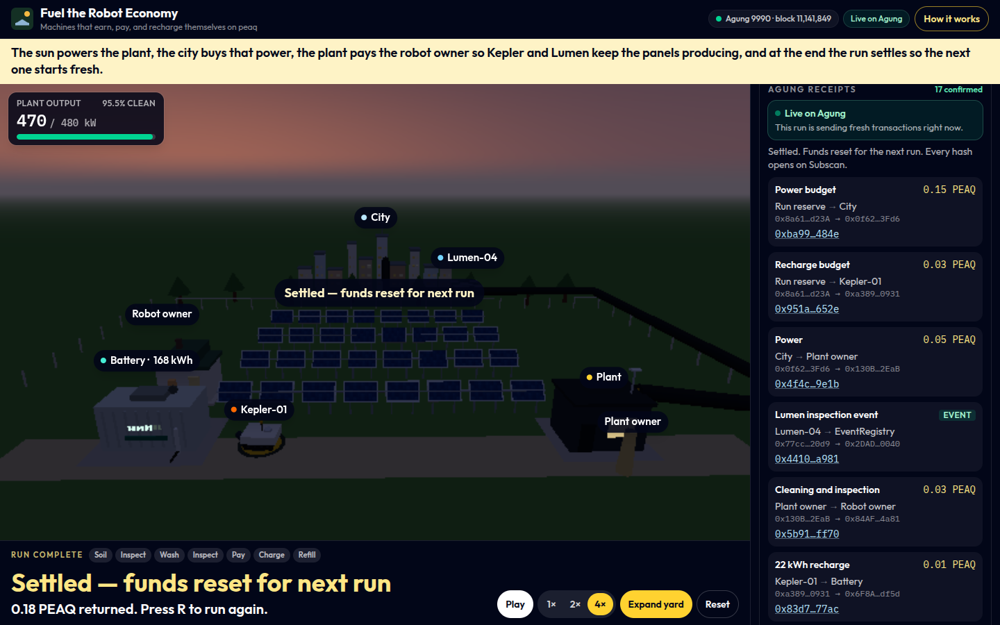
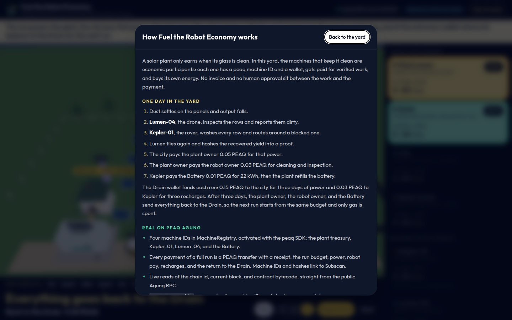
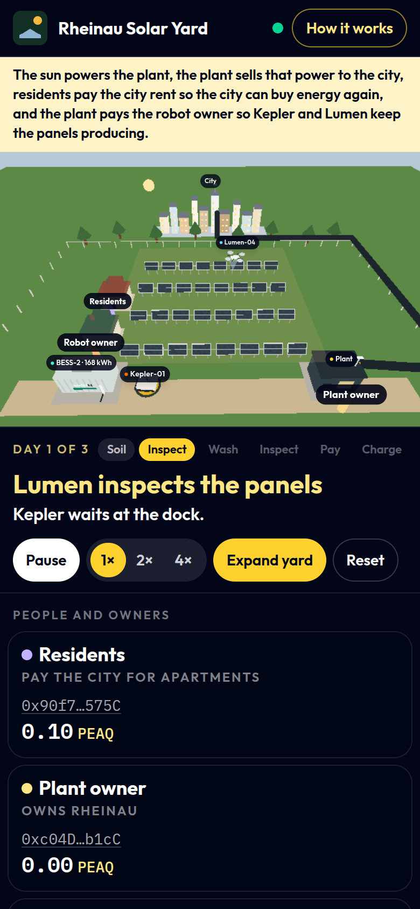

# Fuel the Robot Economy

**Machines that earn, pay, and recharge themselves on peaq.**

A solar plant only earns when its glass is clean. Fuel the Robot Economy is a live 3D solar farm in the browser. The machines that keep it clean are economic participants: a cleaning rover, an inspection drone, and a battery pack each hold a **peaq machine ID** and a wallet. They get paid for **verified work** and **buy their own energy**, settled on the peaq **Agung** testnet, with no invoice and no human approval in the loop.

Built for the [Germany side track: Advance the Machine Economy with peaq](https://superteam.fun/earn/listing/build-solutions-advancing-the-machine-economy-with-peaq) (Crypto World's Fair).

**Live demo:** [fuel-the-robot-economy.vercel.app](https://fuel-the-robot-economy.vercel.app). Opening it starts a live run: a server-side writer sends that visit's payments and Lumen's inspection events to Agung, and every receipt links to Subscan. No wallet or login is needed.



## How it advances the Machine Economy

Most "robot fleet" demos stop at telemetry. Fuel the Robot Economy closes the economic loop around one real job:

1. **Proof of work, by a machine.** Lumen-04 (drone) inspects the array before and after the wash, hashes the recovered yield into a proof (the same `computeDataHash` bytes as the peaq SDK), and reports the inspection to peaq's EventRegistry from its own wallet.
2. **Payment released by that proof.** The city buys the recovered power from the plant owner, and the plant owner pays the robot owner for Kepler-01's cleaning and Lumen-04's inspection.
3. **Machine-to-machine energy purchase.** Kepler-01 pays the Battery for 22 kWh to recharge from its own wallet. The plant refills the Battery from its own generation.
4. **A loop that can run forever.** A run reserve funds each run (the city's power budget and Kepler's recharge budget). After three days, the plant owner, the robot owner, and the Battery send everything back, so the next run starts from the same budget and only gas is spent.

This is the listing's "two machines, one deal" idea (a robot paying a charger) in an energy DePIN, with identity, proof, and settlement in one working loop rather than five partial features.

**Why it matters.** After sunlight itself, dust is the biggest factor in how much a solar plant produces: it costs 3–5% of global solar output, around €3–5 billion a year ([IEA-PVPS 2022](https://iea-pvps.org/key-topics/soiling-losses-impact-on-the-performance-of-photovoltaic-power-plants/)). Cleaning robots already exist. What's missing is a way for them to sell verified cleaning to the plant, buy their own charging, and build a payment history that can back credit and financing, without an operator in the loop. That is what this yard runs.

## What is real on peaq, and what is simulated

| Real on Agung (chain id 9990) | Simulated |
| --- | --- |
| **4 machine IDs** in MachineRegistry, activated with `@peaqos/peaq-os-sdk` `activateMachine` (plant treasury, Kepler-01, Lumen-04, Battery), all owned by the yard operator | Rover, drone, soiling, and battery physics (browser, no hardware) |
| **Every payment of a full run is a PEAQ transfer with a receipt**: the run budget, power, robot pay, recharges, and the settlement, 14 transfers per run, sent fresh for each visit. Every hash links to [Subscan](https://agung-testnet.subscan.io) | Plant output, soiling, and the recovered kW feed the proof and the payments, but come from the simulation |
| **Lumen-04's inspection events** in EventRegistry, one per day, signed from Lumen's own wallet as machine 352 (activity, self-reported trust). They sit in the receipts next to the payment they unlock | When another visitor's run holds the wallets, a rate limit is hit, or the reserve is low, the page says so and replays the run below |
| Live reads: chain id, current block, MachineRegistry, DID precompile, and EventRegistry bytecode, plus wallet balances over the public RPC | |

Do not take the labels on trust:

```bash
npm run verify
```

This recomputes each machine ID with the peaq SDK, checks that MachineRegistry reports the operator as owner, fetches the four activation receipts, matches every transfer of the recorded run on sender, recipient, and amount, and decodes each inspection event: sent by Lumen-04 to EventRegistry, for machine 352, with a matching on-chain event count.

### Machines

| Machine | Address | MachineRegistry ID | Activation |
| --- | --- | --- | --- |
| Plant treasury (machine type `Rheinau-treasury`) | [`0x8a61…d23A`](https://agung-testnet.subscan.io/account/0x8a61248e23e04b97A0A42A87D09459573478d23A) | `33972125727311862102242550464936382332590305066238494161796118837764432459771` | [`0xec8a…1859`](https://agung-testnet.subscan.io/tx/0xec8a622a893f77ed675902751ea196e5336ad11339a0bd3fc34e50f6d33c1859) |
| Kepler-01 (rover) | [`0xa389…0931`](https://agung-testnet.subscan.io/account/0xa3893E09F5546B56B6e845ad194e28a216730931) | `1962884760408859527843867200144780974073261720970703856069487751650844150575` | [`0xde6e…b990`](https://agung-testnet.subscan.io/tx/0xde6ee8f2b2b2b6154034bb7ea763865c9616241a61484a284dabedaa0517b990) |
| Lumen-04 (drone) | [`0x77cc…20d9`](https://agung-testnet.subscan.io/account/0x77cc0A6aeA9F14c842251aE1384E45A3F30320d9) | `70771729342491203195750444655678312409844457848436599576321158744592664857524` | [`0xd25a…b671`](https://agung-testnet.subscan.io/tx/0xd25a7b8a143b87a9ee0418d5b1370c75f902f1367f890d367535a0390030b671) |
| Battery (machine type BESS-2) | [`0x6F8A…df5d`](https://agung-testnet.subscan.io/account/0x6F8A86803dafE766F6381F781D5003BC5aa2df5d) | `23561826428746862383207998597570184258462227245211301004858601842139846427384` | [`0xae8d…dcf5`](https://agung-testnet.subscan.io/tx/0xae8de92ad5772c5d0fb4084316917235325b0e6c5200cfe12aa2065c666edcf5) |

The operator [`0x8a61…d23A`](https://agung-testnet.subscan.io/account/0x8a61248e23e04b97A0A42A87D09459573478d23A) was funded from the peaq Gas Station. Its wallet is also the run reserve. The city, plant owner, robot owner, and machine wallets are derived from its key in memory.

Agung's EventRegistry (`0x2DAD…0040`) is still the Tokenomics 1.0 contract: a 9-argument `submitEvent` keyed by IdentityRegistry 1.0 ids. Lumen-04 holds id 352 there, and the writer calls that ABI directly because SDK 0.8 encodes a newer 10-argument call.

### One recorded run

Every visit sends a run like this one. The page replays it only when it cannot send its own; the legs are in [`src/peaq/replayRun.ts`](src/peaq/replayRun.ts), written by `scripts/record-run.ts`. The reserve sent out 0.18 PEAQ and got 0.18 PEAQ back.

| Step | Amount (PEAQ) | From → To | Receipt |
| --- | --- | --- | --- |
| Start: power budget | 0.15 | Run reserve → City | [`0x8c05…e682`](https://agung-testnet.subscan.io/tx/0x8c05475e142de7e26bb7419e944f76775fe024dbf8690f716fb6724febf9e682) |
| Start: recharge budget | 0.03 | Run reserve → Kepler-01 | [`0xa403…49cf`](https://agung-testnet.subscan.io/tx/0xa403ca950a91802e4d20329fc2ae6319f6106614f2f2a1cdeff44d569a7049cf) |
| Day 1 power | 0.05 | City → Plant owner | [`0xba52…6411`](https://agung-testnet.subscan.io/tx/0xba522f9c7d17b8963715d1232cd35ccf8eef355a12d9c6fbd66cc99af07f6411) |
| Day 1 Lumen inspection event | event | Lumen-04 → EventRegistry | [`0xaae1…7b52`](https://agung-testnet.subscan.io/tx/0xaae177aab20fe1f78904ca3ca1419ddd30d9c8c5dc143af2001dab8ad3b97b52) |
| Day 1 cleaning and inspection | 0.03 | Plant owner → Robot owner | [`0xbd3e…35f5`](https://agung-testnet.subscan.io/tx/0xbd3ee91fb01d633c4d20c4d30e5908caa0cca5d069668cc20205444a9e5735f5) |
| Day 1 recharge, 22 kWh | 0.01 | Kepler-01 → Battery | [`0x74f8…2382`](https://agung-testnet.subscan.io/tx/0x74f87b14596dca9414096cc5d65cc13eb51e042df72f0d9103e1c2f603ea2382) |
| Day 2 power | 0.05 | City → Plant owner | [`0xa733…9b83`](https://agung-testnet.subscan.io/tx/0xa733425bcdf4f2568995773f01e857e4fd56886a627eaab69ea61472eb4d9b83) |
| Day 2 Lumen inspection event | event | Lumen-04 → EventRegistry | [`0xd934…cb8b`](https://agung-testnet.subscan.io/tx/0xd9347a5a63fd178b13b4ca16db5f934c826c8c1d6ba58838005cb83484c7cb8b) |
| Day 2 cleaning and inspection | 0.03 | Plant owner → Robot owner | [`0xb508…1d2e`](https://agung-testnet.subscan.io/tx/0xb508212f0b1fcc93647743d51cc8cdfe0c136a1c9f8ec0db4f6196270e091d2e) |
| Day 2 recharge, 22 kWh | 0.01 | Kepler-01 → Battery | [`0x7d4e…df32`](https://agung-testnet.subscan.io/tx/0x7d4e47c5b40c9a94bcef1a5ffaa7415ea146be47bbbfa4a17b8b0c1024efdf32) |
| Day 3 power | 0.05 | City → Plant owner | [`0xec4a…972c`](https://agung-testnet.subscan.io/tx/0xec4a7dd67d725b286caaf95d8cdfc75b16c96f5c12e1491edee4c037c867972c) |
| Day 3 Lumen inspection event | event | Lumen-04 → EventRegistry | [`0x4a28…1f79`](https://agung-testnet.subscan.io/tx/0x4a28ce350f0011171a8c7830a635ba1ffaba88645255b7825084d9cd8d5e1f79) |
| Day 3 cleaning and inspection | 0.03 | Plant owner → Robot owner | [`0x0fdb…901a`](https://agung-testnet.subscan.io/tx/0x0fdb3a703ac388f766b92641edfdc29f26ceceb0cd398e1273bb58731bf9901a) |
| Day 3 recharge, 22 kWh | 0.01 | Kepler-01 → Battery | [`0xb4cc…5eff`](https://agung-testnet.subscan.io/tx/0xb4cc425f1556464c214f9938a5890bfdbb5eb65ce39027f82c7e78c48b9c5eff) |
| End: settlement | 0.06 | Plant owner → Run reserve | [`0x3454…9b4f`](https://agung-testnet.subscan.io/tx/0x345411930f6741c4523cd7b7b986f2c3284db56a0c3614cc9c8be290dc7d9b4f) |
| End: settlement | 0.09 | Robot owner → Run reserve | [`0xb68d…5393`](https://agung-testnet.subscan.io/tx/0xb68d012152928929aef7329fec2ee7f8c1c3b16bc049d382bc45e82329ff5393) |
| End: settlement | 0.03 | Battery → Run reserve | [`0xe27e…3920`](https://agung-testnet.subscan.io/tx/0xe27e331be887e333316c1e063b6cd9db293d951733bd8a3acb94ebb78eec3920) |

Subscan shows Agung's testnet token as AGNG. The app calls it PEAQ.

## Run it

Requires Node 22.6+ (the server uses `--experimental-strip-types`). Without a key the page replays the recorded run; with one it sends live runs.

```bash
npm install
npm run peaq    # yard server on :4318 (Agung reads, receipts, optional writer)
npm run dev     # page on http://127.0.0.1:4317, proxies /api to :4318
```

Or as a single production process:

```bash
npm run build && npm start   # serves the page and /api on http://127.0.0.1:4317
```

The page also works as a static build with no server. It then shows the verified machine IDs and replays the recorded run from the browser.

| Command | What it does |
| --- | --- |
| `npm run verify` | Re-checks machine IDs, all receipts, and Lumen's events on Agung |
| `node --experimental-strip-types scripts/record-run.ts [url] [--write]` | Sends one full run through a writer, the way the page does; `--write` stores it as the replay run |
| `npm run sim` | Ledger self-test, plus checks that the browser constants still match the peaq SDK |
| `npm run lint` / `npm run build` | oxlint, then typecheck and production bundle |

**Controls:** Space pause · 1 / 2 / 4 speed · R restart · F expand the yard · H "How it works". Drag to orbit, scroll or pinch to zoom. One day takes about 55 s at 1×, and a full three-day run about 40 s at 4×.

### Sending live runs

With a funded Agung key, the writer activates any missing machines (`activateMachine`, entry bond read from `MachineSubscription.requiredPeaqAmount(0)`, 0.4 PEAQ on Agung) and then sends each payment and each inspection event while the page plays. Locally, copy `.env.example` to `.env`, which is git-ignored, and set `PEAQOS_PRIVATE_KEY` or `PEAQOS_PRIVATE_KEY_FILE`. Put the treasury private key only in the environment or in a file outside the repo. Child wallets for the machines and owners are derived from that key in memory, on the server only.

The receipts panel then says "Live on Agung". Every page load and every restart (R) is a new run with new transactions. Receipts never carry over from an earlier run.

**Shared wallets, one run at a time.** All runs use the same wallets, so the writer lets one run hold them at a time. A run that sends nothing for two minutes gives them up, and a reload from the same connection takes over its own unfinished run. Each connection may start 6 live runs an hour, and the writer 40 in total. The first job of a run is refused when the reserve holds less than 0.25 PEAQ. A refused run switches to the recorded run and the panel says why. When a run is cut short, its budget stays in the city and owner wallets, and the next run returns it to the reserve before it is funded.

**Cost.** The 0.18 PEAQ budget comes back at the end of every run, so a run costs only gas: about 1.0 × 10⁻⁹ PEAQ (14 transfers at 21,000 gas and 3 events at about 258,000 gas, gas price 1,024 wei). The reserve's 2.39 PEAQ covers that for about two billion runs, and Lumen's 0.01 PEAQ pays for its events for about 13 million runs. Agung tokens are free from the [peaq Gas Station](https://depinstation.peaq.xyz) (5 PEAQ per new wallet). The first start costs 1.6 PEAQ in bonds.

## Screenshots

| Run complete: every payment has an Agung hash | How it works: real vs simulated | Mobile |
| --- | --- | --- |
|  |  |  |

## How it is built

- **Scene:** React 19, React Three Fiber, and drei (`src/scene`). The rover follows a wash route around a blocked row (`src/world/layout.ts`).
- **Economy:** a deterministic engine (`src/economy/engine.ts`) drives phases, wallets, and the chain jobs each payment should produce. `npm run sim` asserts the balances.
- **peaq:** viem reads Agung from the browser (`src/peaq/agung.ts`). The writer (`server/chain.ts`) signs transfers and EventRegistry calls with viem and uses `@peaqos/peaq-os-sdk` for machine IDs and activation. The browser never imports either the SDK or the writer.
- **Writer:** the page posts each chain job to `/api/peaq/settle` in order, one at a time per run (`src/peaq/useYardChain.ts`). The jobs are the run budget, each day's power, work (inspection event plus payment), and recharge, then the settlement. In code the reserve wallet is still called the Drain (`PersonId` `drain`): it funds each run and receives the settlement sweep. `server/guard.ts` holds the one-run lease and the rate limits.
- **Robotics framing:** rover and drone signals are named as ROS 2 topics would be (`/rover/battery`, `/array/yield_kw`, …). ROS 2 is not required. peaqOS ships a ROS 2 node (`peaq_ros2_peaqos`) for real hardware.

## Deploy

**Vercel (the live demo).** `npm run build:vercel` builds the page, bundles the writer into three Node functions (`/api/peaq`, `/api/peaq/settle`, `/api/peaq/enroll`), and writes both to `.vercel/output` (Build Output API). The operator key is read server-side only: from `PEAQOS_PRIVATE_KEY` if set (add it as a Sensitive environment variable), otherwise from a private Vercel Blob store connected to the project. To put the key into that store without pasting it anywhere, post it once to the deployment:

```bash
node -e 'process.stdout.write(JSON.stringify({key:require("fs").readFileSync(process.argv[1],"utf8").trim()}))' /path/agung.key \
  | curl -sS -X POST https://<deployment>/api/peaq/enroll -H 'content-type: application/json' --data-binary @-
```

The endpoint only accepts the key that controls the operator address, so nobody else can swap in a wallet. Neither the static bundle nor any response contains key material.

**Static (any CDN).** Serve `dist/` from `npm run build`. Without the writer, the page shows the verified machine IDs and replays the recorded run.

**With the yard server (Docker).** This serves the page and `/api`, and sends live runs when a key is mounted:

```bash
docker build -t fuel-the-robot-economy .
docker run --rm -p 4317:4317 fuel-the-robot-economy
```

Add `-e PEAQOS_PRIVATE_KEY_FILE=/run/secrets/agung.key -v /path/agung.key:/run/secrets/agung.key:ro` to enable writes. `deploy/Caddyfile` terminates HTTPS in front of port 4317.

## Demo video

A narrated walkthrough (2:45) covers one full day, the receipts on Subscan, a 4× run to settlement, and the "How it works" guide. The timed script is in [`docs/demo-script.md`](docs/demo-script.md).
